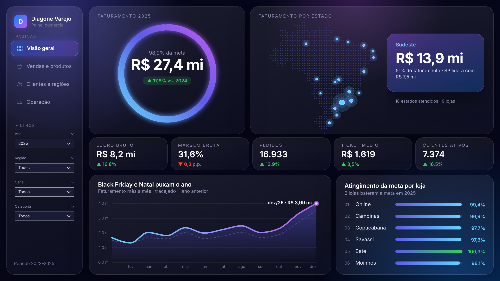
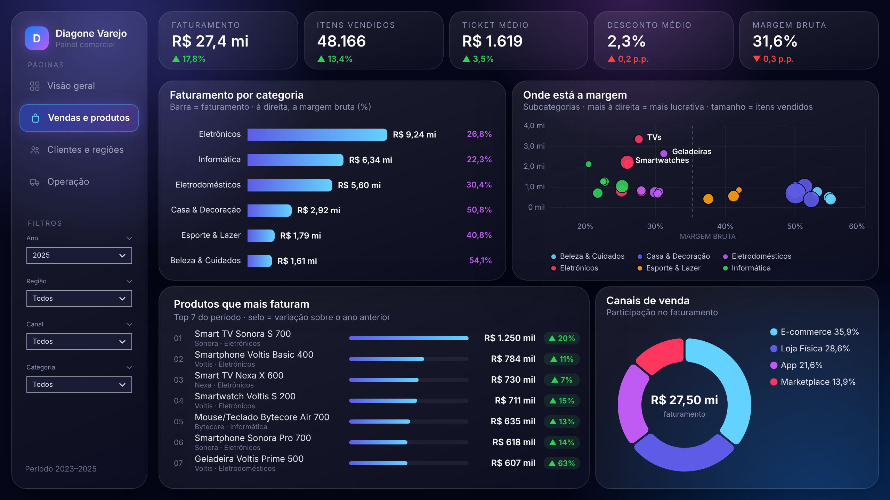
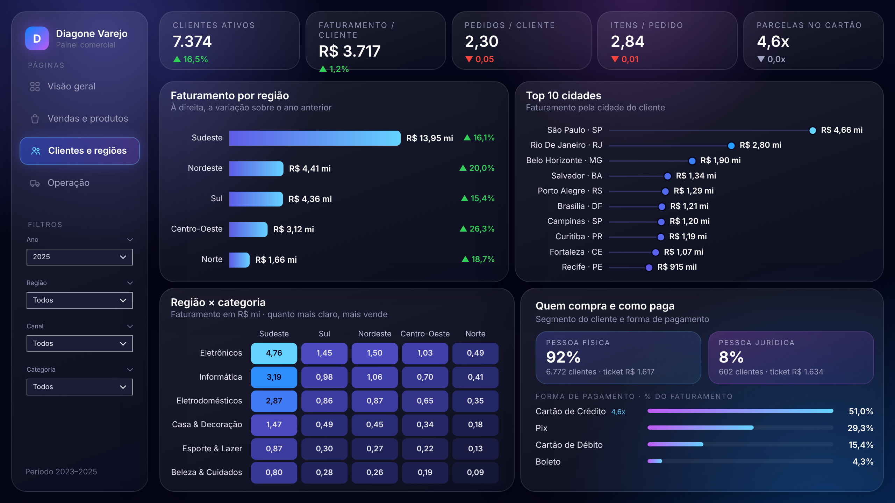
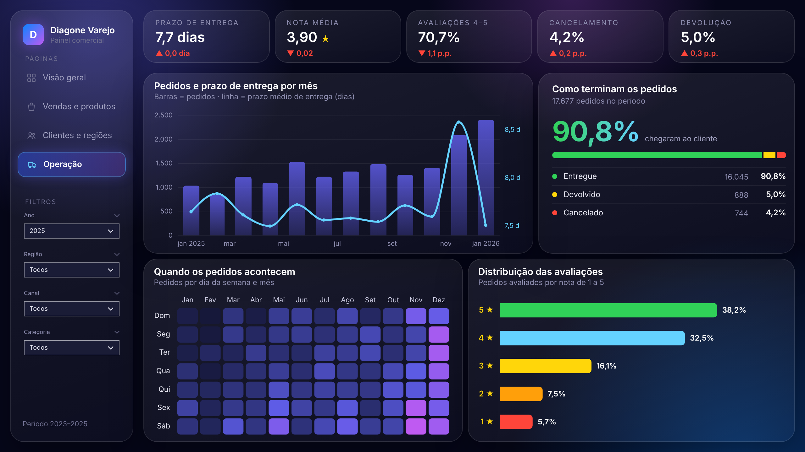
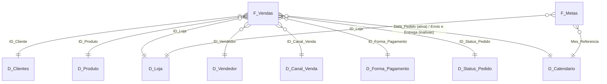

# Diagone Varejo · Dashboard comercial em Power BI com Deneb e HTML

Dashboard de varejo construído do zero no Power BI: tratamento no Power Query, modelo estrela, 48 medidas DAX e visuais personalizados feitos com **Deneb (Vega-Lite)** e **HTML/CSS/SVG gerado por DAX**. O projeto foi desenvolvido em parceria com o **Claude (IA da Anthropic)**, usado como copiloto de dados e de design.



> Base fictícia (2023–2025), criada só para este estudo: 75.813 linhas de vendas, 10 mil clientes, 189 produtos, 10 lojas e metas mensais.

---

## As 4 páginas

| Vendas e produtos | Clientes e regiões |
|---|---|
|  |  |

| Operação | |
|---|---|
|  | |

| Página | Perguntas que responde |
|---|---|
| **Visão geral** | Quanto vendemos, quanto da meta batemos, onde vendemos e como as lojas estão contra a meta |
| **Vendas e produtos** | Quais categorias e produtos puxam o faturamento e onde está a margem |
| **Clientes e regiões** | Quem compra, de onde, como paga e como cada região cresceu |
| **Operação** | Prazo de entrega, avaliações, cancelamentos, devoluções e quando os pedidos acontecem |

Todas as páginas têm menu lateral, filtros sincronizados (Ano, Região, Canal e Categoria) e comparação automática com o ano anterior (▲ verde = melhorou, ▼ vermelho = piorou).

---

## O caminho, do zero ao dashboard

### 1. Base de dados
O Claude gerou uma base consolidada de varejo com "sujeira" proposital para treinar a limpeza: espaços extras, textos em minúsculas, datas em formatos diferentes, `pix` e `Pix` misturados e linhas duplicadas.

### 2. Power Query: tratamento (feito por mim)
- **Consulta "mãe" `Base_Vendas`**, só de limpeza e com carga desabilitada. Todas as tabelas do modelo nascem como **Referência** dela. Lição aprendida: nunca mesclar dentro da própria base, senão vira dependência circular.
- **Limpeza:** Cortar (aparar espaços) nas colunas de texto, Colocar Cada Palavra em Maiúscula em nome, cidade e categoria, padronizar `pix → Pix` e remover duplicatas da tabela inteira (76.040 → 75.813 linhas).
- **Dimensões com ID** (Clientes, Produto, Loja, Vendedor): duplicatas removidas **pelo ID**, não pelo nome, que pode se repetir.
- **Dimensões sem ID** (Canal, Forma de Pagamento, Status): mantida só a coluna de texto, removidas as duplicatas e depois criada uma **Coluna de Índice** como chave.
- **Fato `F_Vendas`:** Mesclar Consultas com as dimensões de índice para trazer os IDs e, depois, remover as colunas descritivas. Ficam só chaves, datas e valores.
- **Parâmetro `PastaDados`:** o caminho dos CSVs fica num parâmetro, então o projeto abre em qualquer computador.

### 3. Modelo estrela (feito por mim)



- 2 tabelas fato (`F_Vendas` e `F_Metas`, esta por loja × mês) e 8 dimensões.
- 12 relacionamentos muitos-para-um, com filtro em direção única.
- **`D_Calendario` em DAX**, marcada como tabela de datas e cobrindo do primeiro ao último ano das fatos. Ela se liga a **todas** as datas das fatos: `Data_Pedido` é a relação ativa, e `Data_Envio` e `Data_Entrega` são inativas, usadas com `USERELATIONSHIP`. Datas de atributo, como nascimento e cadastro, não se ligam ao calendário.

### 4. Medidas DAX (48, organizadas em 6 pastas)

| Pasta | Exemplos |
|---|---|
| 01 Vendas | Faturamento, Lucro Bruto, Margem Bruta %, % Desconto |
| 02 Pedidos e Clientes | Pedidos, Ticket Médio, Clientes Ativos, Taxa de Cancelamento |
| 03 Logística e Satisfação | Prazo Médio de Entrega, Nota Média, % Avaliações Positivas |
| 04 Inteligência de Tempo | Faturamento AA, Var. %, Acumulado no Ano, Média Móvel 3M |
| 05 Metas | Meta, Atingimento %, Gap, Lojas que Bateram a Meta |
| 06 HTML | Medidas que geram os cards em HTML/CSS/SVG |

```dax
Faturamento =
CALCULATE (
    SUMX ( F_Vendas, F_Vendas[Quantidade] * F_Vendas[Preco_Unitario] * ( 1 - F_Vendas[Desconto_Perc] ) ),
    KEEPFILTERS ( D_Status_Pedido[Status_Pedido] <> "Cancelado" )
)

Faturamento AA =
IF ( NOT ISBLANK ( [Faturamento] ), CALCULATE ( [Faturamento], SAMEPERIODLASTYEAR ( D_Calendario[Data] ) ) )

Pedidos Enviados (data de envio) =
CALCULATE ( [Pedidos], USERELATIONSHIP ( F_Vendas[Data_Envio], D_Calendario[Data] ) )
```

### 5. Visuais: Deneb + HTML
A regra do projeto: **gráficos em Deneb, cards e tabelas ricas em HTML.**

**Deneb (Vega-Lite):** 11 gráficos, com as specs completas na pasta [`deneb/`](deneb/).
- Linha com área em degradê, ano anterior tracejado e anotação automática do mês de pico.
- **Mapa do Brasil pontilhado sem visual de mapa nativo:** 884 pontos formam o país, e cada estado é posicionado por *lookup* de coordenadas e ganha um brilho proporcional ao faturamento.
- Barras com margem ao lado, bolhas de margem × faturamento (com legenda clicável), rosca com total no centro, lollipop das top 10 cidades, mapas de calor e barras + linha em dois eixos.

**HTML Content alimentado por DAX:** cada medida da pasta `06 HTML` monta uma string de HTML/CSS/SVG que muda com os filtros. O código está em [`html/medidas_html.dax`](html/medidas_html.dax).
- **Anel de meta** em SVG: o `stroke-dasharray` é calculado em DAX a partir do % de atingimento.
- **Faixa de KPIs** em vidro (*glassmorphism*), com ▲▼ e variação sobre o ano anterior. Em métricas como cancelamento e prazo, subir é ruim, então a cor se inverte.
- Ranking de lojas × meta, top produtos com selo de crescimento, perfil de clientes e status dos pedidos.

### 6. Design
- **Tema escuro "Dark Modern":** fundos com brilho (*aurora*), cards de vidro e degradê azul → roxo.
- **Fundo de cada página feito em HTML e renderizado como PNG.** Os visuais ficam transparentes por cima e encaixam nas molduras.
- **Menu lateral próprio:** os nomes das páginas fazem parte do fundo (com a página atual destacada), e botões transparentes com ação de navegação ficam por cima.
- **Cada visual passou por 3 opções de design** antes da escolhida ir para o código.

---

## Como o Claude (IA) entrou no projeto

Usei o Claude como um analista sênior ao lado, não como piloto automático. A modelagem eu fiz com as minhas mãos e o Claude revisou, explicou e corrigiu junto comigo.

| Etapa | O que eu fiz | Como o Claude ajudou |
|---|---|---|
| Base de dados | Defini o tema e o escopo | Gerou a base fictícia com problemas reais de qualidade |
| Power Query | Fiz toda a limpeza, as dimensões, os índices e as mesclas | Revisou os arquivos, explicou erros (dependência circular, deduplicação pelo campo errado) e ensinou o porquê de cada etapa |
| Modelagem | Montei o modelo estrela, o calendário e os relacionamentos | Conferiu cardinalidade, direção de filtro e relações ativas e inativas |
| DAX | Validei os números | Escreveu as 48 medidas e testou cada uma com consultas DAX direto no modelo |
| Visuais | Escolhia entre 3 opções de design por visual | Criou as specs Deneb e as medidas HTML/CSS/SVG |
| Ajustes | Testava no Power BI e apontava problemas | Editava os arquivos do projeto, validava e corrigia |

**Ferramentas do Claude usadas:**
- **Power BI Modeling MCP:** conexão direta com o modelo aberto no Power BI Desktop para ler tabelas, criar medidas e rodar consultas DAX de validação.
- **Formato PBIP (PBIR + TMDL):** como o relatório é salvo em texto, o Claude pôde editar páginas, visuais e medidas como código.
- **Skills de Deneb** (estilo premium e referência técnica) para padronizar os gráficos.

---

## Tecnologias
Power BI Desktop · Power Query (M) · DAX · Deneb / Vega-Lite · HTML, CSS e SVG · PBIP (PBIR + TMDL) · Claude (Anthropic) com Power BI Modeling MCP

## Como abrir o projeto
1. Instale o **Power BI Desktop** (versão recente, com suporte a PBIP).
2. Clone ou baixe este repositório.
3. Abra `Projeto Varejo.pbip`.
4. Em **Transformar dados → Gerenciar parâmetros**, troque `PastaDados` pelo caminho da pasta `dados` na sua máquina, terminando com `\`.
5. Clique em **Atualizar**. Os visuais Deneb e HTML Content são carregados da loja de visuais, então é preciso estar conectado à internet.

> No Power BI Desktop, os botões do menu lateral precisam de **Ctrl + clique**. Publicado, funciona com clique simples.

## Estrutura do repositório
```
├── Projeto Varejo.pbip               # abre o projeto
├── Projeto Varejo.Report/            # páginas e visuais (PBIR, em JSON)
├── Projeto Varejo.SemanticModel/     # modelo, Power Query e medidas (TMDL)
├── dados/                            # CSVs de vendas e metas
├── deneb/                            # specs Vega-Lite de cada gráfico
├── html/                             # medidas DAX que geram HTML/CSS/SVG
└── assets/                           # imagens deste README
```

## Aprendizados
- A consulta "mãe" só limpa. Quem mescla são as referências.
- Remover duplicatas sempre pela chave (ID), nunca pelo nome.
- Definir os nomes finais das colunas **antes** das mesclas, porque renomear depois quebra a etapa de expansão.
- O calendário cobre todas as datas das fatos, e as relações extras ficam inativas para uso com `USERELATIONSHIP`.
- Comparações com o ano anterior só fazem sentido com um ano selecionado, por isso o filtro já abre no ano mais recente.
- O PBIP transforma o relatório em código, o que permite versionar no GitHub e trabalhar junto com IA.
